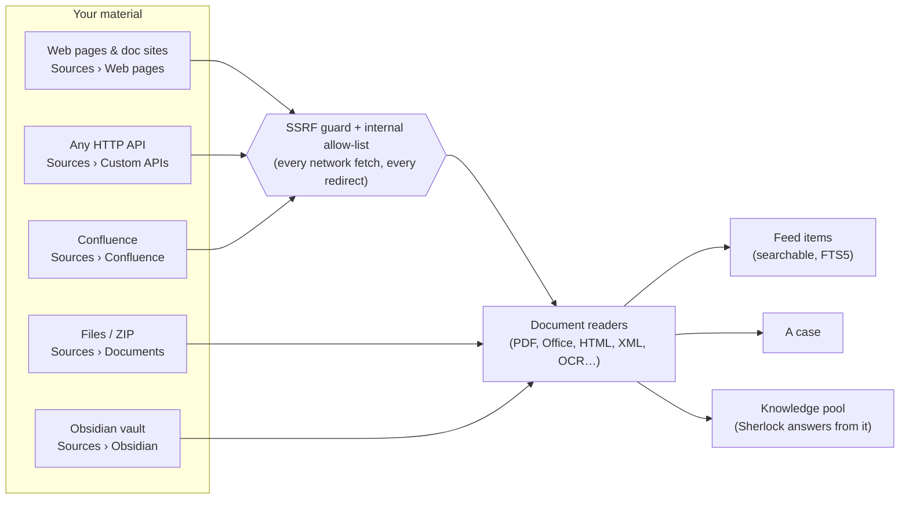

# Bringing your own data into Nexus-OSINT

Besides the built-in open sources (RSS, Google News, Reddit, GDELT and the
optional keyed services), Nexus can take in **your** material: files, internal
web pages and documentation sites, any HTTP API, a Confluence wiki and an
Obsidian vault. This guide explains each path, how to connect it step by step,
where its secrets live, and what the safety limits are.

All examples use fictional hosts (`wiki.example.corp`, `api.example.org`,
`docs.example.internal`).

- [Overview](#overview)
- [Where data lands: case vs knowledge pool](#where-data-lands-case-vs-knowledge-pool)
- [Privacy: cloud AI and the "no AI" option](#privacy-cloud-ai-and-the-no-ai-option)
- [1. Upload files](#1-upload-files)
- [2. Watch web pages and documentation sites](#2-watch-web-pages-and-documentation-sites)
- [3. Closed networks: internal allow-list and internal CA](#3-closed-networks-internal-allow-list-and-internal-ca)
- [4. Flexible API sources](#4-flexible-api-sources)
- [5. Confluence (Cloud and Data Center / Server)](#5-confluence-cloud-and-data-center--server)
- [6. Obsidian: import vault and export case](#6-obsidian-import-vault-and-export-case)
- [7. Cloud connectors (read-only)](#7-cloud-connectors-read-only)
- [Security limits at a glance](#security-limits-at-a-glance)
- [Where every secret lives](#where-every-secret-lives)

## Overview



| Path | Where in the app | What it reads | Lands in | Secrets (`.env`) | Re-scans |
|---|---|---|---|---|---|
| File upload | Sources › Documents, or a case's Documents tab | PDF, Office, OpenDocument, CSV, HTML, MHTML, Markdown, JSON/NDJSON, XML, e-mail, RTF, images (OCR), ZIP | Case and/or knowledge pool | none | Re-uploading the same file is a no-op |
| Web pages / doc sites | Sources › Web pages | A page's main text, optionally a same-site crawl | Feed | `WEB_SOURCE_<id>_SECRET` (login, optional) | New page → item; changed page → "what changed" item |
| Closed network | Settings › Internal network | (policy, not a source) | — | `INTERNAL_ALLOWED_HOSTS`, `INTERNAL_ALLOWED_CIDRS`, `INTERNAL_CA_BUNDLE` | — |
| Flexible API sources | Sources › Custom APIs | JSON, NDJSON, XML, CSV, RSS/Atom, HTML | Feed | `CUSTOM_SOURCE_<id>_KEY`, `CUSTOM_SOURCE_<id>_HEADERS` | Every scan; Auto-Adapt re-maps drifted fields |
| Confluence | Sources › Confluence | Pages, optionally blog posts, comments, attachments | Case and/or knowledge pool | `CONFLUENCE_SOURCE_<id>_TOKEN` | Only new/changed pages (watermark + version) |
| Cloud connectors | Sources › Cloud connectors | Notion pages | Case and/or knowledge pool | `CLOUD_SOURCE_<id>_TOKEN` | Only new/changed content (watermark + version) |
| Obsidian import | Sources › Obsidian (or upload a zipped vault) | Notes, frontmatter, tags, links, embedded files | Case and/or knowledge pool | none | New, changed and deleted notes |
| Obsidian export | Case page › "Obsidian: export case (.zip)" | (outbound: a case as a vault) | A ZIP you download | none | — |

Every path degrades gracefully: a missing optional parser (for example `pypdf`
or PyYAML) switches off only that one format, and a broken source never stops
the others from scanning.

## Where data lands: case vs knowledge pool

- **Feed items.** Watched web pages and custom API sources produce ordinary
  feed items. They are searchable, enriched and scored like any other source,
  and you pin them into a case from the feed.
- **A case.** Uploads, Confluence connections and Obsidian vaults can target
  one case directly. Their documents appear on the case's Documents tab and
  their items are pinned into it.
- **The knowledge pool.** This is reference material that is not tied to a case
  (manuals, background reports, an internal wiki). Sherlock searches it when it
  answers questions. A case target can also be added to the pool ("also add to
  the knowledge pool").

Deleting a source (a Confluence connection or an Obsidian vault entry) stops
future imports. Documents already imported stay under Documents until you
delete them there.

## Privacy: cloud AI and the "no AI" option

Collection reads your material locally. **AI enrichment** (summary,
translation, threat level, entities, question scoring) sends the text of an
item to whichever AI provider is active:

- With a **cloud provider** (Gemini, OpenAI, Anthropic, Grok), every form that
  imports your own material shows a warning. The "Allow cloud AI" box **starts
  unticked**, so by default the material never leaves the machine.
- A **"no AI"** import is skipped by automatic enrichment and is never shown to
  a cloud model by Sherlock. A local model may still read it.
- With a **local model** (Ollama, LM Studio, llama.cpp, vLLM…) or no AI at all,
  nothing leaves the machine. See
  [Run a fully local model](FEATURES.md#run-a-fully-local-model-no-cloud-no-data-leaves-your-machine).

## 1. Upload files

1. Open **Sources › Documents**, or the **Documents** tab of a case.
2. Choose one or many files, or a ZIP.
3. Under "Where should these go?", pick the knowledge pool or a case.
4. Leave the AI box unticked to keep the text away from a cloud model. Then
   upload.

**Supported formats:**
- PDF (per page).
- Word `.docx` (per heading section, tables included).
- Excel `.xlsx` (per sheet).
- PowerPoint `.pptx` (per slide, with notes).
- OpenDocument `.odt/.ods/.odp`.
- CSV/TSV, HTML, saved pages `.mhtml`, Markdown/text (per heading).
- JSON and NDJSON (per record), XML/RSS/Atom (per record).
- E-mail `.eml` with attachments, RTF.
- Images, read with OCR when Tesseract is installed.
- Scanned PDFs: a page with no real text layer is rendered in memory and read
  with OCR (needs Tesseract and `pypdfium2`). Pages that already have text are
  not touched, so a mixed PDF costs only its scanned pages. Limits per document:
  200 pages, 10 minutes in total, 60 seconds per page, and very large pages are
  scaled down. Beyond a limit, or without the engine, the file is still stored
  and the upload result says which pages were not read.
- ZIP archives. A ZIP export of a wiki or documentation site (Confluence,
  MediaWiki, MkDocs, Sphinx…) is read page by page. A ZIP containing an
  `.obsidian/` folder is read as an Obsidian vault.

Other formats are read on a best-effort basis.

Each page, section, sheet or slide becomes a searchable item, split into chunks
of about 4,000 characters. The original file is kept under `DATA_DIR/uploads/`
and can be downloaded again from the document list. It is never served inline.

## 2. Watch web pages and documentation sites

1. Open **Sources › Web pages** → "Watch a page or site".
2. Enter the **Address**, for example `https://docs.example.internal/handbook/`.
3. Optionally crawl the same site: set a **Link depth** (max 3), **Max pages**
   (max 200), "stay under this path", and **Seconds between pages** (at least
   0.5 s, default 1 s).
4. **Login** (optional): None, Basic (`user:password`), Bearer token, Custom
   header (with its header name), or Cookie. The secret goes to `.env` as
   `WEB_SOURCE_<id>_SECRET`.
5. **TLS certificate**: "Verify normally" (recommended), "Trust my internal CA",
   or "Do NOT verify".
6. Press **Add**, then **Test** to fetch only the start page. **Scan now**
   checks this one source.

On each scan, a page seen for the first time becomes an item. A known page
whose text changed gets a short summary of the added and removed lines. The
crawl honours `robots.txt` and never leaves the start host. Linked
PDF/DOCX/JSON files are read with the upload readers.

## 3. Closed networks: internal allow-list and internal CA

By default every server-side fetch refuses private, intranet addresses. To
reach `wiki.example.corp` or an internal API:

1. Open **Settings › Internal network**, or edit `.env`:
   ```ini
   INTERNAL_ALLOWED_HOSTS=wiki.example.corp,*.docs.example.internal
   INTERNAL_ALLOWED_CIDRS=10.20.0.0/16
   INTERNAL_CA_BUNDLE=C:\certs\example-corp-root.pem
   ```
2. In the source's own form (web page, custom API or Confluence), set the TLS
   option to **"Trust my internal CA"**. Prefer this over "Do NOT verify", which
   is only for a self-signed test server.

The same policy covers web pages, custom APIs (and the AI planner's docs
fetch), Confluence, feeds and evidence capture. Every redirect hop is checked
again. Loopback, link-local / cloud metadata (`169.254.x`), reserved addresses
and the app's own port stay blocked **even if listed**. Allowed internal
connections show as "Internal network (allowed)" in the Security center.

With no network path at all, use the upload route instead: a saved page
(`.mhtml`), a site's ZIP export, or a zipped Obsidian vault.

## 4. Flexible API sources

**Let the AI set it up (optional):**
1. Open **Sources › Custom APIs** → "Let the AI set it up".
2. Give a **Docs URL** (for example `https://api.example.org/docs`), a **Sample
   response** (any format), and/or a **Hint**.
3. Press **Draft the configuration**. The planner fills the form below for you
   to review. It needs a connected AI provider. Without one, fill the same form
   by hand.

**The configuration form:**

| Group | Fields |
|---|---|
| Endpoint | Name, Base URL (`https://api.example.org`), Endpoint path, Method (GET or POST), Search query param, Extra query params (JSON) |
| POST body | A JSON template; `{query}` is replaced by the search term, for example `{"q": "{query}", "size": 50}` |
| Format | Response format: auto, JSON, NDJSON, XML, CSV, RSS/Atom or HTML. Auto looks at the Content-Type and the body. XML is parsed with `defusedxml` |
| Mapping | Items path, and the fields for Content, Title, URL, Author and Published date. **With no mapping**, each record is stored as readable `key: value` text, so items still arrive |
| Pagination | Type: none, page number, offset/limit, cursor, or next-page link. Set the page/offset/cursor param, first page number, page size param and size, and the cursor or next-link path (blank = use the `Link` header). Max pages per scan: 1–20. A next link may never leave the API host |
| Auth | none, header, query parameter, bearer, Basic (`user:password`), or OAuth2 client credentials (token URL + scope; the access token is cached in memory only). Optional extra headers (not secret) and secret headers (JSON) |
| TLS | Verify, trust the internal CA, or (explicitly) do not verify |

Press **Save source**, then **Test** for a live fetch.

Secrets are written to `.env` only:

```ini
CUSTOM_SOURCE_7_KEY=...            # API key, bearer token, "user:password" or OAuth2 client secret
CUSTOM_SOURCE_7_HEADERS={"X-Api-Key": "..."}
```

**Auto-Adapt** watches each custom source. If the API still answers but its
response shape drifts so that nothing is collected, the AI re-maps the fields
from the latest response, even when it is not JSON. This is bounded by a
threshold and a cooldown, and only runs when an AI provider is connected.

## 5. Confluence (Cloud and Data Center / Server)

1. Open **Sources › Confluence** → "Connect Confluence".
2. **Edition**:
   - *Confluence Cloud*: the **Site URL** (the address you open your Cloud
     site at), the **account e-mail**, and an **API token** (sent as Basic
     auth).
   - *Data Center / Server*: base URL including any context path, for example
     `https://wiki.example.corp/confluence`, and a **Personal Access Token**
     (sent as Bearer). An intranet host needs the internal allow-list
     ([section 3](#3-closed-networks-internal-allow-list-and-internal-ca)).
3. Optionally fill in **Spaces** (keys) and/or a **CQL filter**, for example
   `space = OPS and label = runbook`. Set **Pages per scan** and decide whether
   to include blog posts, comments and attachments.
4. Under "Where should the pages go?", pick the knowledge pool or a case. Then
   decide whether to allow AI, and press **Connect**.
5. **Test connection** lists the spaces the account can read; tick the ones to
   pull. Then press **Scan now**, or let the next scan pick it up.

The token is stored in `.env` as `CONFLUENCE_SOURCE_<id>_TOKEN`. It is never
written to the database, the page or a log.

What arrives:
- One document per page, with clean text plus metadata: title, space, labels,
  author, version, last-modified time, web link and breadcrumb.
- Attachments go through the document readers.

How it reads:
- Cloud spaces are read with REST v2 (cursor paging). Data Center, and any CQL
  query, use REST v1 content search.
- Later scans read only new and changed pages: a watermark on the last-modified
  time plus the stored version number.
- A changed page gets its new text plus a short "what changed" item.
- HTTP 429 is retried after `Retry-After`. If the page cap is hit, the scan
  resumes on the next run.

## 6. Obsidian: import vault and export case

**Import a vault folder:**
1. Open **Sources › Obsidian** → "Obsidian: import vault".
2. Enter the **Vault folder on this computer**, for example
   `~/vaults/research`, and optionally a name.
3. Optional **Filters**: only these folders, skip these folders, and only notes
   with a given tag (for example `#osint`).
4. Choose the target (knowledge pool or a case) and the AI option. Then press
   **Add vault**.
5. **Test** shows how many notes and files are readable. **Scan now** imports
   them.

How the vault is read:
- The import **only reads** the folder. (Writing notes back is a separate,
  opt-in feature limited to one subfolder; see [PUBLISHING.md](PUBLISHING.md).
  Notes Nexus wrote itself are skipped by the import.)
- Hidden folders (`.obsidian/`, `.trash/`, `.git/`…) are skipped, and a
  symlink never leads out of the vault.
- Frontmatter is parsed with `yaml.safe_load` only.

What is kept from each note:
- Tags from the frontmatter and inline `#tags` (not inside code).
- `[[wikilinks]]` and `![[embeds]]`, stored as metadata.
- Embedded PDFs, images and Office files found in the vault, read through the
  document readers.
- Long notes are split at their headings.

Re-scans:
- A note is read again only when its modification time or size changed.
- A note is stored again only when its content changed. It then gets its new
  text plus a "what changed" item.
- Notes deleted from the vault are removed.

The vault path is configured on this page, not in `.env`, because it is not a
secret.

**No folder access?** Zip the vault and upload it under **Sources ›
Documents**. A ZIP with an `.obsidian/` folder is recognised and parsed the
same way.

**Export the other way:** on a case page, **"Obsidian: export case (.zip)"**
writes the case as a vault you can open in Obsidian. To write single items or
write-ups straight into your vault (or to Confluence), see
[PUBLISHING.md](PUBLISHING.md).

*Link graph:* wikilinks are searchable ("Linked notes") and stored in their
own `note_links` table, rebuilt after every scan of the vault. A target with a
folder (`[[Projects/Alpha]]`) matches that path; a bare name (`[[Alpha]]`)
matches the note with that file name (the shortest path wins); a link to a note
that does not exist yet is kept and resolves once that note appears. On the
Graph page, **Show Obsidian notes** draws the notes that name entities on the
map, with arrows for wikilinks and dashed lines to the entities they name (up
to 40 notes). Vaults scanned by an older version are back-filled on start-up.

## 7. Cloud connectors (read-only)

**Sources › Cloud connectors** reads content you already have on a cloud service
into a case or the knowledge pool. All of them share the same rules:

- **Read-only.** Nexus only lists and reads; it never changes anything there.
- **Fixed destinations.** Requests go over https to that service's own hosts and
  nowhere else; the Security center lists them as expected.
- **Only what changed.** Each scan reads new and changed content, up to the
  "Most per scan" number; the rest follows next scan. Rate limits are waited out.
- **AI is off by default** for this content. Tick "Allow AI enrichment" to change
  that for a connection.
- **The token stays in `.env`** as `CLOUD_SOURCE_<id>_TOKEN`: never in the
  database, the page, a log or a backup.
- Disconnecting removes the token; what was already read stays under Documents.

### Notion

1. At notion.so/my-integrations, create an internal integration with the **Read
   content** capability and copy its secret.
2. In Notion, open each page to read, then **Connections**, and add the
   integration. Sub-pages follow. This is how pages are chosen: an integration
   sees nothing else.
3. Paste the secret under "Connect Notion", then press **Test connection** and
   **Scan now**.

Text blocks, headings, lists, to-dos, tables and code are read, including nested
blocks; a database row keeps its properties as text. Images and attached files
are not downloaded. A page deleted in Notion stays in Nexus until you delete it
under Documents.

## Security limits at a glance

| Area | Limit / rule |
|---|---|
| Uploads | 50 MB per file, 200 MB per upload, 200 files per upload |
| ZIP archives | 2,000 entries, 500 MB expanded; compression ratio and nesting depth checked; member paths cannot escape the archive |
| Parsing | XML via `defusedxml` (no entity expansion); Office macros never run; HTML scripts dropped; YAML via `safe_load` only |
| Web crawl | Same host only, depth ≤ 3, ≤ 200 pages, ≥ 0.5 s between requests, `robots.txt` honoured |
| Custom APIs | ≤ 20 pages per scan, 10 MB per response, next links stay on the API host |
| Obsidian | 5 MB per note, 10,000 notes and 500 MB per scan, read-only, no symlink escape |
| Network | Public addresses only, unless allow-listed; loopback, metadata and the app's own port are always blocked; every redirect hop is re-checked |
| Imported files | Checked by the local file scanner (ClamAV if installed; optional VirusTotal hash lookup) |
| App | Binds to `127.0.0.1` only |

## Where every secret lives

All secrets are in `.env`, which git ignores. They are written there by the
forms, never stored in the database and never shown back in the UI.

| Key | Written by | Holds |
|---|---|---|
| `WEB_SOURCE_<id>_SECRET` | Sources › Web pages | Basic `user:password`, bearer token, header value or Cookie string |
| `CUSTOM_SOURCE_<id>_KEY` | Sources › Custom APIs | API key, bearer token, Basic `user:password` or OAuth2 client secret |
| `CUSTOM_SOURCE_<id>_HEADERS` | Sources › Custom APIs | Secret headers as a JSON object |
| `CONFLUENCE_SOURCE_<id>_TOKEN` | Sources › Confluence | Cloud API token or Data Center PAT |
| `INTERNAL_ALLOWED_HOSTS` / `INTERNAL_ALLOWED_CIDRS` | Settings › Internal network | Allowed intranet hosts / networks (not secret, but kept with the policy) |
| `INTERNAL_CA_BUNDLE` | Settings › Internal network | Path to your internal CA (PEM) |
